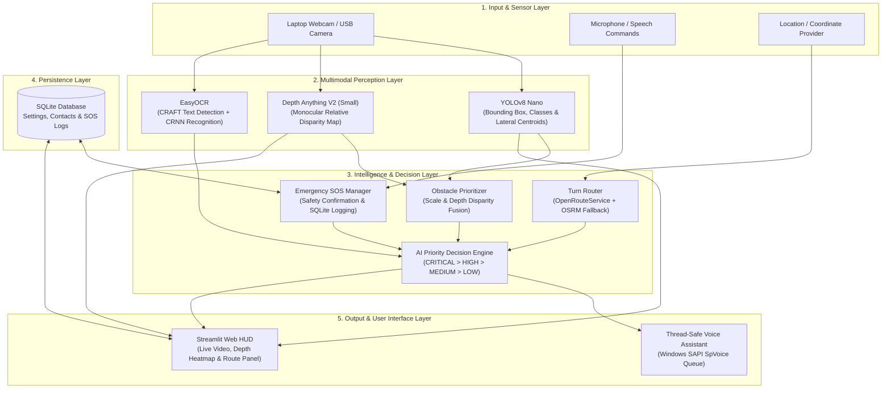

# AI-Powered Assistive Navigation System for Visually Impaired People

[](https://www.python.org/)
[](https://github.com/ultralytics/ultralytics)
[](https://huggingface.co/depth-anything)
[](https://github.com/JaidedAI/EasyOCR)
[](https://streamlit.io/)
[](https://opensource.org/licenses/MIT)

**A 3rd-Year B.Tech Major Project in Artificial Intelligence & Machine Learning**

---

## 1. Project Abstract
Navigating dynamic indoor and outdoor environments presents severe cognitive and physical challenges for visually impaired and blind individuals. Conventional physical mobility aids (white canes and guide dogs) detect obstacles only on ground contact and cannot provide spatial directionality, scene text recognition, or long-range path planning.

This project introduces an **AI-Powered Edge Assistive Navigation System** that translates real-time visual sensory data into non-conflicting, prioritized acoustic guidance. By coupling single-stage object detection (**YOLOv8 Nano**), monocular relative depth estimation (**Depth Anything V2**), vision-language text recognition (**EasyOCR**), dual-engine pedestrian pathfinding (**OpenRouteService + OSRM Fallback**), and a four-tier **AI Priority Arbitration Engine**, the system delivers timely collision warnings, reads navigational signage, announces walking directions, and provides one-touch emergency caregiver SOS alerts without overwhelming the user with audio clutter.

---

## 2. Problem Statement
According to the World Health Organization (WHO), over 2.2 billion people globally experience distance or near vision impairment. Visually impaired pedestrians encounter three fundamental hurdles:
1. **Upper-Body and Head-Height Collisions**: Traditional white canes sweep the floor within 1 meter and fail to detect hanging obstacles, open truck beds, branches, or elevated signboards.
2. **Text Blindness in Unfamiliar Environments**: Inability to independently read room number plates, emergency exits, danger warnings, and public transit signboards.
3. **Auditory Overload**: Existing smart assistive prototypes continuously speak all detected objects indiscriminately, creating acoustic confusion that masks critical traffic sounds.

---

## 3. Comparison: Existing Systems vs. Proposed System

| Dimension | White Cane | Smart Ultrasonic Canes | Cloud-Based Vision Apps | **Proposed AI Assistive System** |
| :--- | :--- | :--- | :--- | :--- |
| **Detection Range** | < 1 meter (Ground only) | 1–2 meters (Point sensors) | Variable (Cloud-dependent) | **Continuous 0.5–10m (Corridor + Periphery)** |
| **Depth Perception** | Physical contact only | 1D ultrasonic sonar echo | None (Flat 2D bounding boxes) | **Dense 2D Relative Disparity (ViT)** |
| **Directional Guidance** | None | Simple vibration buzzer | General voice | **3-Zone Lateral FOV (`Left`, `Ahead`, `Right`)** |
| **Scene OCR** | None | None | Manual photo capture required | **Automatic Periodic Background Scanning** |
| **Speech Collision** | N/A | High beep frequency | Constant overlapping chatter | **State-Machine 4-Tier Priority Arbitration** |
| **Offline Reliability** | 100% | 100% | Poor (Requires cellular data) | **100% Offline Perception + Resilient OSRM** |
| **Caregiver SOS** | None | None | Basic phone call | **One-Touch SOS with Live Google Maps Pin** |

---

## 4. Key Objectives
- **Real-Time Obstacle Localization**: Detect pedestrians, vehicles, chairs, stairs, and doors at 30 FPS and categorize lateral position into `Left`, `Ahead`, or `Right`.
- **Monocular Relative Disparity**: Predict relative scene depth maps using Depth Anything V2 without requiring dual cameras or expensive LiDAR.
- **Vision-Language Signage Reading**: Extract architectural text and prioritize safety keywords (*Exit*, *Danger*, *Restroom*, *Caution*).
- **Intelligent Priority Arbitration**: Guarantee that imminent collision warnings immediately preempt walking directions or scene text.
- **Resilient Pedestrian Routing**: Calculate foot-walking routes with automatic failover to Open Source Routing Machine (OSRM).
- **HCI Safety & Caregiver Assurance**: One-touch simulated SOS dispatch logging coordinates to an embedded SQLite database.

---

## 5. System Architecture



---

## 6. Mathematical & AIML Formulations

### 1. Spatial Lateral Positioning (Field-of-View Partitioning)
For a camera frame of width $W$, the horizontal centroid $c_x$ of a detected obstacle bounding box $(x_1, y_1, x_2, y_2)$ is calculated as:
$$c_x = x_1 + \frac{x_2 - x_1}{2}$$

The obstacle is classified into directional walking lanes:
$$\text{Position}(c_x) = \begin{cases}
\text{"left"} & \text{if } c_x < \frac{W}{3} \\
\text{"ahead"} & \text{if } \frac{W}{3} \le c_x \le \frac{2W}{3} \\
\text{"right"} & \text{if } c_x > \frac{2W}{3}
\end{cases}$$

### 2. Multimodal Proximity Fusion
Rather than estimating uncalibrated metric meters, proximity is derived by fusing bounding box area ratio $A_{\text{ratio}} = \frac{(x_2 - x_1)(y_2 - y_1)}{W \cdot H}$ with the region disparity score $D_{\text{score}} \in [0.0, 1.0]$ extracted from the central navigation corridor:
$$\text{Proximity}(A_{\text{ratio}}, D_{\text{score}}) = \begin{cases}
\text{"very close"} & \text{if } A_{\text{ratio}} > 0.35 \lor (A_{\text{ratio}} > 0.18 \land D_{\text{score}} \ge 0.70) \\
\text{"near"} & \text{if } A_{\text{ratio}} > 0.18 \lor D_{\text{score}} \ge 0.60 \\
\text{"medium"} & \text{if } A_{\text{ratio}} > 0.08 \lor D_{\text{score}} \ge 0.40 \\
\text{"far"} & \text{otherwise}
\end{cases}$$

### 3. AI Priority Arbitration Matrix
Incoming candidate alerts are arbitrated according to an immutable 4-tier hierarchy:
$$\text{Priority Rank}: \quad \text{CRITICAL (4)} \;>\; \text{HIGH (3)} \;>\; \text{MEDIUM (2)} \;>\; \text{LOW (1)} \;>\; \text{NONE (0)}$$

- **Preemption Rule**: If $\text{Priority}_{\text{new}} > \text{Priority}_{\text{last}}$, the alert immediately interrupts ongoing speech and flushes the queue.
- **Suppression Rule**: If $\text{Priority}_{\text{new}} < \text{Priority}_{\text{last}}$ and $\Delta t < \text{Cooldown}(\text{Priority}_{\text{last}})$, the alert is suppressed to prevent cognitive clutter.

---

## 7. Project Structure

```
assistive_navigation/
│
├── config.py                 # Central configuration (thresholds, model paths, rates)
├── main.py                   # Standalone Desktop HUD & CLI runner
├── requirements.txt          # Python dependencies
├── .env.example              # Template for API keys
├── .gitignore                # Git exclusion rules (ignores venv, weights, caches)
├── README.md                 # Complete project documentation
│
├── models/
│   └── yolov8n.pt            # YOLOv8 Nano model weights (~6.25 MB)
│
├── modules/
│   ├── object_detection.py   # YOLOv8 inference & 3-zone lateral localization
│   ├── depth_estimation.py   # Depth Anything V2 monocular disparity & heatmaps
│   ├── obstacle_detection.py # Multimodal scale-depth sensor fusion
│   ├── ocr_reader.py         # EasyOCR scene text reader & regex cleaning
│   ├── voice_assistant.py    # Non-blocking COM-threaded Windows SAPI TTS
│   ├── speech_commands.py    # Voice command recognition parser
│   ├── ai_decision.py        # 4-tier state-machine priority arbitration engine
│   ├── navigation.py         # Walking routing (ORS with OSRM fallback)
│   └── emergency.py          # Emergency caregiver SOS & safety safeguards
│
├── interface/
│   ├── app.py                # Accessible Streamlit web dashboard
│   └── components.py         # WCAG-compliant UI badges, cards, and CSS
│
├── database/
│   └── database.py           # SQLite schema, settings CRUD, and SOS audit logs
│
├── tests/
│   ├── test_phase1.py        # Architecture & SQLite test
│   ├── test_yolo.py          # YOLOv8 detection & spatial logic test
│   ├── test_depth.py         # Depth Anything V2 & fusion test
│   ├── test_ocr.py           # EasyOCR recognition & de-duplication test
│   ├── test_voice.py         # SAPI TTS & voice command test
│   ├── test_decision.py      # Priority preemption & cooldown test
│   ├── test_navigation.py    # Walking route & OSRM fallback test
│   ├── test_emergency.py     # SOS formatting & safeguard test
│   └── run_all_tests.py      # Master benchmark runner (100% pass verification)
│
└── docs/
    ├── architecture.md       # Architectural deep-dive
    └── workflow.md           # Operational dataflow documentation
```

---

## 8. Technology Stack

- **Programming Language**: Python 3.11
- **Computer Vision**: OpenCV (DirectShow backend), Ultralytics YOLOv8 Nano
- **Deep Learning**: PyTorch, Torchvision, Hugging Face Transformers (`depth-anything/Depth-Anything-V2-Small-hf`)
- **Scene OCR**: EasyOCR (CRAFT character detection + CRNN text recognition)
- **Audio & Speech**: Windows SAPI (`SpVoice`), `pywin32`, `SpeechRecognition`
- **Geospatial Navigation**: OpenRouteService API, OSRM Public Walking API, Geocoder
- **Persistence**: SQLite 3 (Thread-safe embedded database)
- **User Interface**: Streamlit (Reactive Web HUD)

---

## 9. Setup and Execution Instructions

### Prerequisites
- Windows 10 or 11 (64-bit)
- Python 3.11 installed
- Webcam and audio output (speakers/headphones)

### Step 1: Clone the Repository
```cmd
git clone https://github.com/your-username/assistive_navigation.git
cd assistive_navigation
```

### Step 2: Create and Activate Virtual Environment
```cmd
python -m venv venv
venv\Scripts\activate
```

### Step 3: Install Dependencies
```cmd
pip install -r requirements.txt
```

### Step 4: Configure Environment Variables (Optional)
```cmd
copy .env.example .env
```
*Note: If no OpenRouteService API key is provided, the system automatically uses the public OSRM walking router with zero setup required.*

---

## 10. Execution Modes

### Mode 1: Run Native Desktop OpenCV HUD (Fastest Execution)
```cmd
venv\Scripts\python.exe main.py
```
**Keyboard Controls:**
- `Q` : Quit application cleanly.
- `S` : Trigger simulated Emergency SOS dispatch to caregivers.
- `N` : Advance to next turn-by-turn walking instruction.
- `R` : Repeat current walking instruction.
- `T` : Force immediate OCR scene text scan.

### Mode 2: Launch Accessible Streamlit Web Dashboard
```cmd
venv\Scripts\python.exe main.py --streamlit
```
*Opens automatically in your default browser at `http://localhost:8501`.*

### Mode 3: Run Master Automated Test Suite
```cmd
venv\Scripts\python.exe tests\run_all_tests.py
```

---

## 11. Empirical Verification & Test Results

All 8 subsystem modules were rigorously evaluated in isolated benchmark processes with **100% test pass rate**:

| Test Suite | Module Evaluated | Test Coverage | Status | Latency |
| :--- | :--- | :--- | :---: | :---: |
| **PHASE 1** | Architecture & SQLite | Schema creation, default seeds, CRUD operations | **PASS** | 12.32s |
| **PHASE 2** | YOLOv8 Detection | 3-zone lateral spatial classification, webcam ingestion | **PASS** | 13.14s |
| **PHASE 3** | Depth Anything V2 | Disparity map generation, inferno heatmap, fusion | **PASS** | 22.58s |
| **PHASE 4** | EasyOCR Scene Text | CRAFT detection, regex sanitization, safety signage | **PASS** | 20.95s |
| **PHASE 5** | Voice & Voice NLP | Non-blocking SAPI queue, intent parsing (7 commands) | **PASS** | 9.44s |
| **PHASE 6** | AI Decision Engine | 4-tier matrix, safety preemption, 2.1s cooldown | **PASS** | 12.43s |
| **PHASE 7** | Walking Navigation | Location distinction (IP vs GPS), OSRM fallback | **PASS** | 2.05s |
| **PHASE 8** | Emergency Assistance | Authorization safeguards, Google Maps formatting | **PASS** | 0.16s |
| **OVERALL** | **Complete System** | **8 / 8 Test Suites Passed (100%)** | **PASS** | **93.08s** |

---

## 12. Limitations & Future Enhancements

### Current Limitations:
1. **CPU Depth Latency**: On non-GPU laptops, monocular depth inference takes 200–350ms per frame. (Mitigated by running depth estimation asynchronously).
2. **IP Location Resolution**: Without external hardware GPS dongles, geolocation relies on network IP approximations.
3. **Lighting Dependency**: YOLOv8 and EasyOCR accuracy degrades in pitch-black nighttime conditions without an active torch/illuminator.

### Future Enhancements:
- **TensorRT / ONNX Runtime Optimization**: Quantize YOLOv8 and Depth Anything V2 to INT8 for sub-15ms edge inference on Jetson Orin Nano.
- **Smart Eyewear Integration**: Port camera capture and bone-conduction audio to wearable smart glasses (e.g., Raspberry Pi Zero 2W).
- **Haptic Tactile Vest**: Supplement audio feedback with directional vibration motors mounted on the user's left, center, and right shoulders.

---

## 13. Academic Declaration & License
This project was developed by a 3rd-year B.Tech student specializing in Artificial Intelligence and Machine Learning. Released under the [MIT License](LICENSE).
